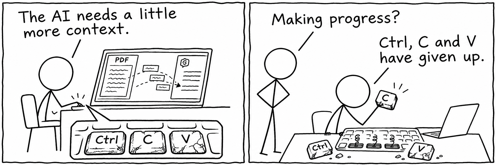
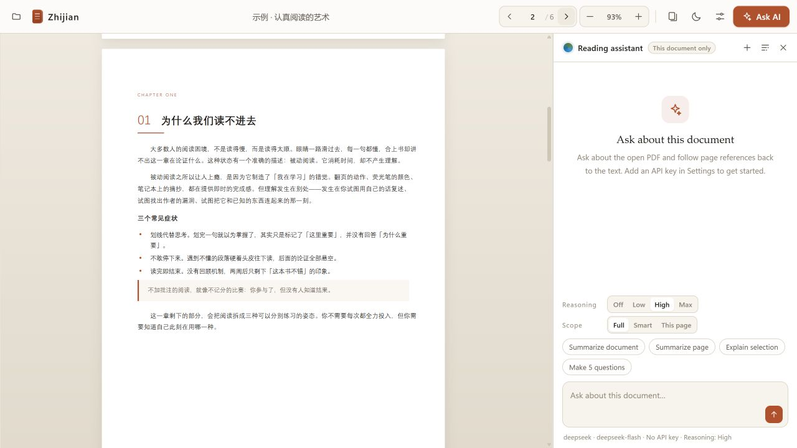
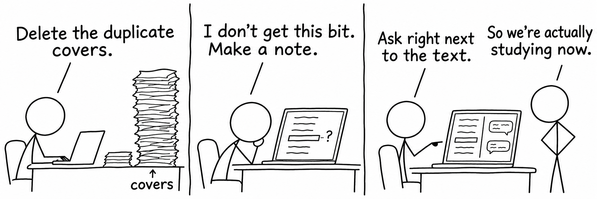

# Zhijian · 纸间

[中文](README.md) · **English**

**Organize your slides. Understand what you're reading. Give Ctrl+C and Ctrl+V a break.**

A local PDF reader with lightweight editing, annotations, and an AI assistant that gets the document context.

[Get started](#get-started) · [What it does](#from-a-pile-of-slides-to-something-you-can-study) · [User guide](docs/USAGE.en.md)

## It started with exam week

Exam week comes with a familiar collection: lecture slides, handouts, extra readings, and last year's notes. We export the slides as PDFs, combine them, remove the pages we don't need, and work through the material again and again.

Then one page stops making sense.

Why does that formula work? How are those two concepts different? Asking AI means switching windows, explaining the course background, copying the surrounding paragraphs, or uploading the entire file. Once we have an answer, we still need to find our place again.

**Zhijian brings these steps together: organize the material, leave a question beside the passage, and ask with the relevant text already included.**

The idea is a small local reader that lets organizing, reading, and understanding happen in one place.

*The English interface showing the built-in Chinese sample: the PDF keeps its original text, while the controls and reading assistant use your chosen language.*

## From a pile of slides to something you can study

### 01 · Make the version you actually want to read

Combine PDF handouts, remove duplicate covers and pages you don't need, or insert a blank page. Save the result to the original file or keep a separate study copy.

The next review session starts with the material that matters.

### 02 · Keep the important bits—and the confusing ones

Select text to highlight, underline, or add a note. Write down the condition behind a result or your own explanation of an idea. Annotations are grouped by page; click one to return to the passage.

Reopen the same PDF to pick up where you left off.

### 03 · Ask with the document context

Select a passage and choose **Ask AI**. You can also summarize the document, summarize the current page, or generate five review questions.

> “Using the definitions around this passage, explain how this conclusion follows.”
>
> “Summarize the key concepts in this chapter, then give me a few questions to check my understanding.”

Zhijian sends the selected document scope with page labels to your model. Click a page reference in an answer to check the source. Each PDF has its own chat history, and you can branch a conversation to explore another explanation.

## A few things that make reading easier

| What you need | How Zhijian helps |
| --- | --- |
| Find your way around | Contents, thumbnails, page navigation, and fit-to-width zoom |
| Give the model enough context | Choose Full, Smart relevant pages, or This page and its neighbors |
| See what the assistant received | A context label on each answer; a notice when a long document falls back to relevant pages |
| Read formulas and tables | Math rendering and Markdown tables in AI answers |
| Use your preferred model | Configure DeepSeek, OpenAI, or another OpenAI-compatible endpoint |
| Read after dark | Six color themes, dark mode, and smart PDF inversion or dimming |
| Choose your interface language | Settings → Interface language → 中文 / English; applied immediately and remembered |

## Get started

The current launcher targets **Windows, Node.js 18 or later, and Microsoft Edge**.

1. Download and extract the project, keeping the folder intact.
2. Double-click `启动纸间.vbs`, or run `npm start` in the project folder.
3. Drop in a PDF, or select **Try the sample**.
4. To use AI, enter your provider details and API key in Settings. Try **Summarize page**.

The interface starts in Chinese. Choose **设置 → 界面语言 → English** to switch. The assistant's default response language follows the interface; your PDF, notes, and existing messages are preserved in their original language.

Reading and page editing do not need a model connection. The frontend libraries are bundled, so normal startup does not require `npm install`.

**Working with PPT/PPTX? Export it to PDF first.**

## Local files, your choice of AI

Reading, annotations, and page editing happen locally. When you use a remote model, the selected text context and chat request are sent through the local service to your configured provider. API charges come from that provider.

Annotations, chat history, and reading position live in this browser's local database. Model settings and API keys are stored locally in `data/config.json`.

### A few practical details

- **The assistant reads the PDF text layer.** Scans need OCR first; page images and charts are not interpreted directly.
- **Annotations live in Zhijian.** They are not embedded in exported PDFs or automatically synced to other computers.
- **Organizing pages rebuilds the PDF.** Keep the original and use Save as for documents with bookmarks, forms, or digital signatures.
- **Page references help you check the answer.** Verify the model's explanation and citations against the source.

See the [user guide](docs/USAGE.en.md) for controls, shortcuts, and development notes.

---

Good luck with your exams. And your keyboard.
