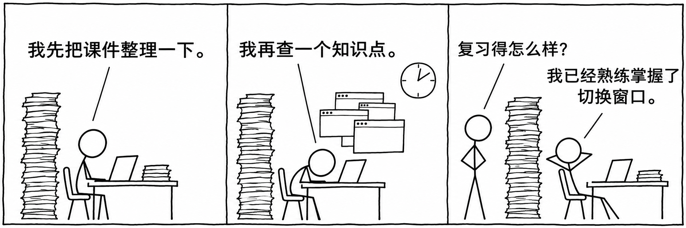
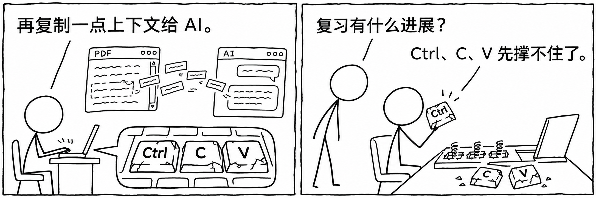
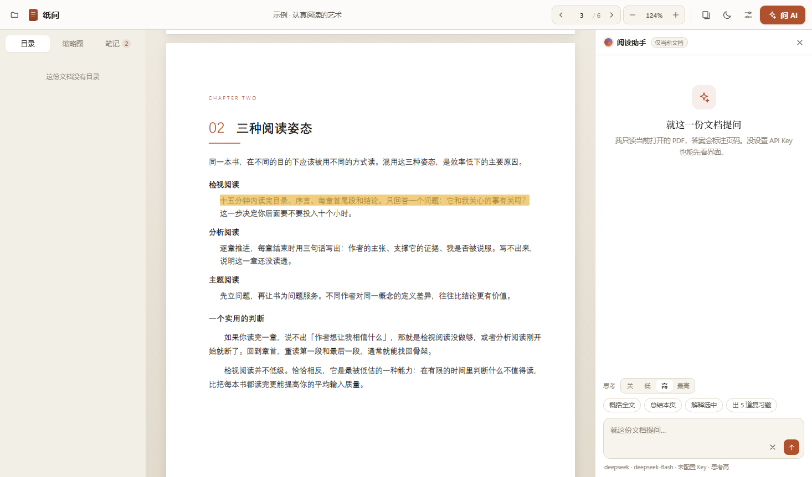
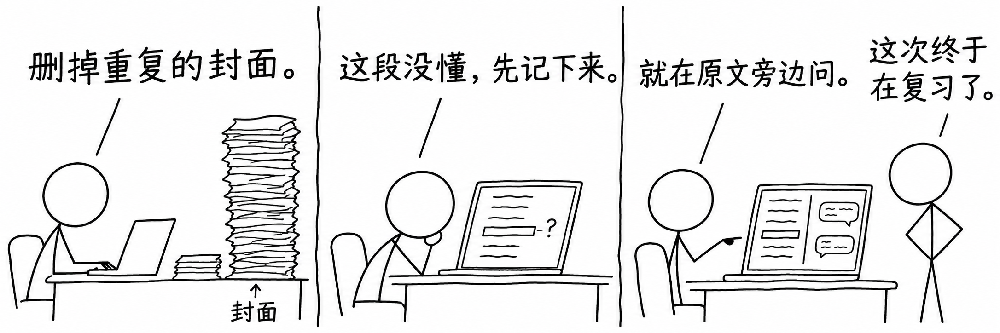

# 纸间 Zhijian

**中文** · [English](README.en.md)

**整理课件，读懂原文。也让 Ctrl+C 和 Ctrl+V 歇一会儿。**

一个本地 PDF 阅读器：轻量编辑、批注笔记，以及带着文档上下文的 AI 问答。

[快速开始](#快速开始) · [看看它能做什么](#从一堆课件到一份读得懂的复习资料) · [使用指南](docs/USAGE.md)

## 从考试周的一件小事开始

考试周，桌面上总会多出一堆课件：老师发的 PPT、课堂讲义、补充材料，还有往年的复习笔记。我们习惯先把 PPT 导出成 PDF，合成一份，删掉不需要的页面，再一遍遍翻看、划重点。

真正打断复习的，往往是某一页没看懂。

一个公式为什么这样推？这两个概念到底有什么区别？切到聊天窗口问 AI，又得重新交代课程背景、复制前后文，或者把整份文件再传一遍。问题解释完了，还要回到课件里找到刚才的位置。

**纸间想把这几件事放在一起：资料可以随手整理，疑问可以留在页边，提问时带上正在读的内容。**

它的出发点很简单：做一个轻巧的本地阅读器，让整理、阅读和理解，成为一段连续的复习过程。

*当前版本的阅读界面，展示内置示例文档。左边找重点，中间读原文，右边解疑问。*

## 从一堆课件，到一份读得懂的复习资料

### 01 · 先整理出自己要读的那一份

把几份 PDF 课件合在一起，删掉重复封面和暂时不用的页面，需要时插入空白页。整理完成后，可以保存到原文件，也可以另存一份复习版。

**资料整理好，下一轮复习就能直接从重点开始。**

### 02 · 把重点和没想通的地方留下来

选中文字，就能高亮、加下划线或写笔记。记下“这个结论的条件是什么”，也记下自己刚刚想明白的解释。所有批注按页汇总，点一下就回到原文。

重新打开同一份文档，还能接着上次的位置读。

### 03 · 带着课件的上下文问 AI

选中一段文字，直接点击「问 AI」；也可以让阅读助手概括全文、总结本页，或生成 5 道复习题。

> “结合前后的定义，解释一下这里为什么能得出这个结论。”
>
> “帮我归纳这一章的关键概念，再出几道题检验我有没有理解。”

纸间会把选定范围的文档文字和页码一起交给模型。回答里的页码引用可以点击，方便回到原文核对。每份 PDF 都有自己的对话历史，同一个问题也可以开分支，换个角度继续问。

## 让工具配合你的阅读习惯

| 你想做的事 | 纸间里的方式 |
| --- | --- |
| 快速浏览整份资料 | 目录、缩略图、页码跳转与适应宽度 |
| 给 AI 足够的背景 | 选择「全文」「智能相关页」或「本页附近」 |
| 知道 AI 这次读了多少 | 每次回答标明附带的文档范围；全文过长时提示改用相关页 |
| 复习里有公式和表格 | AI 回答支持数学公式和 Markdown 表格显示 |
| 使用自己习惯的模型 | 配置 DeepSeek、OpenAI 或其他 OpenAI 兼容接口 |
| 晚上接着读 | 六套配色、深色主题，以及 PDF 智能反色或调暗 |
| 用熟悉的语言操作 | 设置 → 界面语言，中文 / English 即时切换并记住选择 |

## 快速开始

当前启动方式面向 **Windows + Node.js 18 或以上 + Microsoft Edge**。

1. 下载项目并解压，保持整个文件夹完整。
2. 双击 `启动纸间.vbs`，打开纸间窗口；也可以在项目目录运行 `npm start`。
3. 拖入一份 PDF，或点击「看看示例」体验阅读和批注。
4. 需要 AI 时，在设置里填入模型接口和 API Key，然后从一句“帮我总结本页”开始。

界面默认中文，也可以在 **设置 → 界面语言 → English** 中切换。AI 默认回答语言跟随界面；已有的 PDF、笔记和聊天原文保持原样。

阅读和页面整理无需配置模型。运行所需的前端库已随项目提供，正常启动无需先执行 `npm install`。

**如果手头是 PPT/PPTX，请先导出为 PDF，再用纸间整理和阅读。**

## 文件在本地，AI 由你选择

PDF 的阅读、批注和页面整理在本机完成。使用远程模型时，纸间会通过本地服务，将所选范围的文档文字和本次对话请求发给你配置的模型服务商；API 调用费用由服务商收取。

批注、对话和阅读位置保存在当前浏览器的本地数据库中；模型设置与 API Key 保存在本机的 `data/config.json` 中。

### 使用前了解这几件事

- **目前读取 PDF 文字层。** 扫描件需要先 OCR；AI 不会直接识别页面里的图像与图表。
- **批注保存在纸间里。** 它们不会嵌入导出的 PDF，也不会自动同步到其他电脑。
- **整理页面会重建文件。** 包含书签、表单或数字签名的文档，建议保留原件、另存复习版。
- **带页码，方便核对。** 模型生成的解释和引用仍需要结合原文判断。

更多操作、快捷键与开发说明，见 [完整使用指南](docs/USAGE.md)。

---

祝复习顺利。键盘也是。
