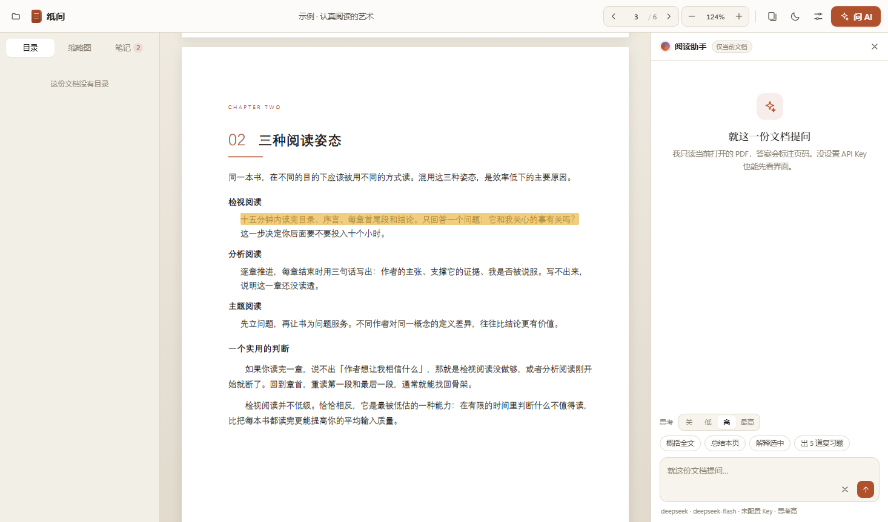

# 纸间 Zhijian

**中文** · [English](USAGE.en.md) · [项目首页](../README.md)

## 界面语言

在 **设置 → 界面语言** 中选择 **中文 / English**，立即生效并在当前浏览器记住。菜单、提示、内置帮助、页面整理和聊天操作都会切换；新请求的 AI 默认回答语言跟随界面。PDF 原文、笔记和已有聊天内容保持原样。

一个很小、很安静的 PDF 阅读器。三个功能，不多不少：

1. **批注 / 笔记** —— 选中即高亮，可以写笔记，左侧按页汇总。
2. **页面整理** —— 删除、插入空白页、插入别的 PDF 的页面，直接写回文件。
3. **AI 助手** —— 只读当前这一份 PDF，回答带页码引用，点一下就跳过去。

不需要注册，不需要上传，文件留在你自己的电脑上。



---

## 启动

**双击桌面上的「纸间」图标**（安装时已创建），或者双击文件夹里的 `启动纸间.vbs`。

没有黑框，几秒后会在 Edge 里弹出一个无地址栏的窗口，就像原生应用。想看到日志就用 `启动纸间.bat`。

环境要求：Windows + [Node.js](https://nodejs.org) 18 以上（本机已装）+ Microsoft Edge。

> 重复双击不会开出第二个服务：新启动会先检测 8720 上是否已经有纸间在跑，有就直接打开窗口。
> 这一点很重要——浏览器的批注和对话按「地址+端口」存放，换端口等于换了一个空仓库。

第一次打开会看到拖放区，点「看看示例」可以先读一份内置的 6 页小册子。

---

## 1 · 批注与笔记

- 用鼠标选中任意文字，会浮出一条工具条：**四色高亮 · 下划线 · 笔记 · 问 AI**
- 写了笔记的批注，左侧会出现一个小圆点标记，点它可以**编辑笔记 / 就这段提问 / 删除**
- 左栏切到「笔记」，所有批注按页码排列，点一条就跳到原文并闪一下
- 关掉再打开同一个 PDF，批注会自动恢复（存在浏览器 IndexedDB 里，按「文件名 + 大小 + 修改时间」识别）

快捷键：选中后按 `H` 直接高亮。

## 2 · 页面整理

点顶栏的「整理页面」进入缩略图视图：

- 每页右下角三个按钮：**前面插空白页 / 后面插空白页 / 删除**（删除后可以撤销）
- 「插入其他 PDF」把另一个文件的页面追加进来
- 「保存到文件」覆盖原文件（前提是你用「打开」选择文件，拿到了写入权限）
- 「另存为」另存一份

> 保存时会用 pdf-lib 重建 PDF。**原文件的书签、表单、数字签名、加密会丢失**，正文内容和批注位置会保留。

## 3 · AI 助手（只读当前 PDF）

右侧面板，默认就开着。

**配置**：右上角齿轮 → 选 DeepSeek → 填 API Key → 保存。

- 默认模型是 **DeepSeek V4.1 Flash**（接口名 `deepseek-flash`）。点下面的「V4 Pro」可以换成 `deepseek-v4-pro`。
- 换成 OpenAI 或中转站时，点模型右边的 **「从接口获取列表」**，会直接请求 `{API 地址}/models`，把对方返回的模型名全部列出来，点一个就选中。不写死预设，接口有什么就能选什么。
- 也支持任何 OpenAI 兼容接口：把「模型服务」切到**自定义**，填中转站地址或本地 Ollama（如 `http://127.0.0.1:11434/v1`）。
- 底部会显示当前模型和思考档位；没配 Key 时显示「未配置 Key」。

**思考强度**：输入框上方有「思考 关 / 低 / 高 / 最高」，每次提问前都能改，设置会被记住。

| 档位 | 发给接口的参数 | 适合 |
| --- | --- | --- |
| 关 | `thinking: {type: "disabled"}` | 快速总结、翻译，要快 |
| 低 | `reasoning_effort: "low"` | 日常问答 |
| 高 | `reasoning_effort: "high"` | 默认，需要推理的问题 |
| 最高 | `reasoning_effort: "max"` | 复杂论证、多步推断（慢） |

开着思考时模型会先输出思维链，界面上以灰色小字显示在答案上方；DeepSeek 官方接口在思考模式下会忽略 `temperature`，程序也会自动不发送它。

如果某个中转站不认识这些参数导致报错，勾选设置里的**兼容模式**即可完全关闭。

**它是怎么读文档的**

- 只提取**当前打开的这份 PDF** 的文字，加上页码标记后发给模型，不联网搜索、不读别的文件。
- 输入框上方有「**范围**」：`全文`（默认，整份文档都给）/ `智能`（按问题挑最相关的页）/ `本页`（当前页 ±1 页）。旁边会显示这份文档大约多少字。
- 每条回答开头都会有一个小标签，**如实写明这次给了模型什么**，例如「已附上全文 · 240 页 · 18.2 万字」或「已附上相关 14 / 240 页 · 1.1 万字」。
- 选「全文」但文档超过约 90 万字（≈60 万 token）时，会自动降级成「智能」，并在标签里说明原因——不会悄悄截断。
- 提示词要求模型只用文档内容回答，并在句末标 `[p.页码]`；答不出来要明说「文档里没有提到」。如果这次只给了部分页，还会额外告诉模型「不是全文，别猜」。
- 回答里的页码是可点的，点了直接跳到那一页。

**快捷动作**：概括全文 / 总结本页 / 解释选中 / 出 5 道复习题。

**多段对话**：右上角 `+` 开一段新对话，列表图标看历史。每段对话自动用第一个问题命名，可以随时切回去、单独删除。**对话按文件保存**——换一个 PDF 是另一套历史，不会混在一起。

**调整宽度**：拖动聊天面板的**左边缘**可以把它拉宽（300–880px），页面会自动重新适应；双击边缘复位。宽度会被记住。

**改问题 / 分支**：鼠标移到你说过的话上，底下会出现两个小按钮。

- **编辑重问**（只在最后一条提问上）：删掉这条和它的回答，把问题放回输入框，改完直接重发。
- **从这里分支**：原对话完全不动，另开一条带着「这条之前全部内容」的新对话，输入框预填这条问题，改一改就是新分支。比如 A→B→C→D，在 C 上分支，就得到保留的 A→B→C→D 和新的 A→B→C1。

**公式与表格**：模型输出的 `$...$`、`$$...$$`、`\(...\)`、`\[...\]` 会用 KaTeX 渲染成真正的公式（离线内置，不联网）；Markdown 表格也会渲染成表格。长公式横向可滚动。

**追问**：多轮对话保留最近 8 条，回看时历史记录也会一起恢复。

---

## 配色

设置 → 最下面的「配色」，点一下立刻生效，不用保存。

| 方案 | 类型 | 主色 |
| --- | --- | --- |
| 羊皮纸 | 浅色（默认） | 陶土红 |
| 素白 | 浅色 | 石板蓝 |
| 墨蓝 | 浅色 | 墨蓝 |
| 苔绿 | 浅色 | 苔绿 |
| 暗金 | 深色 | 金 |
| 午夜 | 深色 | 夜蓝 |

顶栏右上角的太阳/月亮按钮在「当前浅色 ↔ 上次用的深色」之间快速切换；深色方案下 PDF 纸面会自动压暗一点，不刺眼。

**PDF 夜间显示**（设置里，深色主题下生效）：

| 模式 | 做法 | 适合 |
| --- | --- | --- |
| 智能反色（默认） | 先采样每一页的亮度，只有白底页才做反色（`invert + hue-rotate`），深色页、照片页保持原样 | 大部分讲稿、教材、论文 |
| 调暗 | 不反色，只把纸面亮度降到 55% | 含大量彩色图像、反色会花的文档 |
| 关闭 | 保持 PDF 原始颜色 | 需要严格看原色时 |

智能反色是按页判断的，所以一份文档里白底正文页和彩色封面页可以各用各的。

---

## 快捷键

| 键 | 作用 |
| --- | --- |
| `Ctrl + O` | 打开 PDF |
| `←` `→` / `PageUp` `PageDown` | 上一页 / 下一页 |
| `+` `-` | 放大 / 缩小 |
| 点百分比 | 回到「适应宽度」 |
| `H` | 高亮当前选中 |
| `Esc` | 关掉浮层 / 弹窗 |
| 拖文件进窗口 | 打开 |

应用里也能随时查：**设置 → 顶部「快速上手」→ 快捷键 / 使用说明**。使用说明里写了三个功能怎么用、数据存在哪，不用翻这个文件。

---

## 数据存在哪

| 内容 | 位置 |
| --- | --- |
| 批注、对话、阅读位置 | 浏览器 IndexedDB（`zhijian` 库） |
| API Key、模型设置 | `data/config.json`（纯文本，只在本机） |
| 你的 PDF | 原地不动，只有点「保存到文件」才会被重写 |

AI 请求走本机的 `127.0.0.1` 小服务转发，Key 只出现在你和模型服务商之间。

---

## 已知限制

- **扫描版 PDF** 没有文字层，选不中、也问不了 —— 需要先 OCR。
- **批注不会写进 PDF 文件**，它是应用内的图层；换台电脑打开同一个文件看不到批注。
- **页面整理会重建文件**，书签、表单、签名会丢。
- 超大文档（1000 页以上）首次排版和提取文字会慢几秒，属正常。
- 没有做移动端适配，窄窗口下侧栏会浮起来。

---

## 目录结构

```
zhijian/
├─ server.js              本地服务：静态文件 + LLM 转发 + 配置读写（零依赖）
├─ 启动纸间.vbs            双击启动（隐藏控制台）
├─ 启动纸间.bat            调试用启动（显示日志）
├─ public/
│  ├─ index.html
│  ├─ css/app.css         设计系统
│  ├─ js/app.js           阅读器 / 批注 / 页面整理 / 聊天
│  ├─ js/markdown.js      极简 Markdown 渲染
│  ├─ js/store.js         IndexedDB 封装
│  ├─ vendor/pdfjs/       PDF 渲染（含中文 cmaps）
│  ├─ vendor/pdf-lib.min.js
│  └─ samples/demo.pdf    内置示例
├─ data/config.json       API Key 与模型设置
└─ tools/                 示例生成、截图、mock 模型（开发用）
```

## 开发

vendor 里的 pdfjs / pdf-lib / katex 都已随包提供，正常使用不需要联网安装。升级 KaTeX 时：`npm i katex`，把 `dist/katex.min.js`、`dist/katex.min.css` 和 `dist/fonts` 拷到 `public/vendor/katex/`。

`public/vendor` 里的库已经随包提供，跑起来不需要联网。

```bash
npm install            # 只有改示例或升级依赖时需要
npm run build:demo     # 重新生成 public/samples/demo.pdf
npm start              # 启动（会自动开窗口）
```

`tools/scene.mjs` 是一套无头浏览器脚本，会走一遍「选中 → 高亮 → 笔记 → 整理页面 → 保存 → AI 对话」并截图到 `.tmp/`，用来做回归检查；`tools/mock-llm.js` 是一个假的 OpenAI 接口，所以没有 Key 也能测通整条链路。

